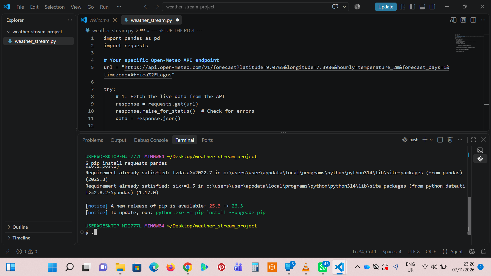
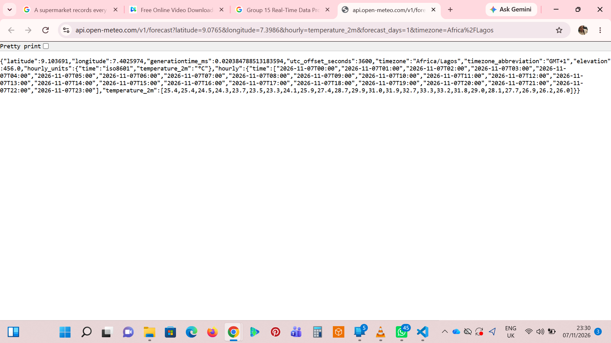
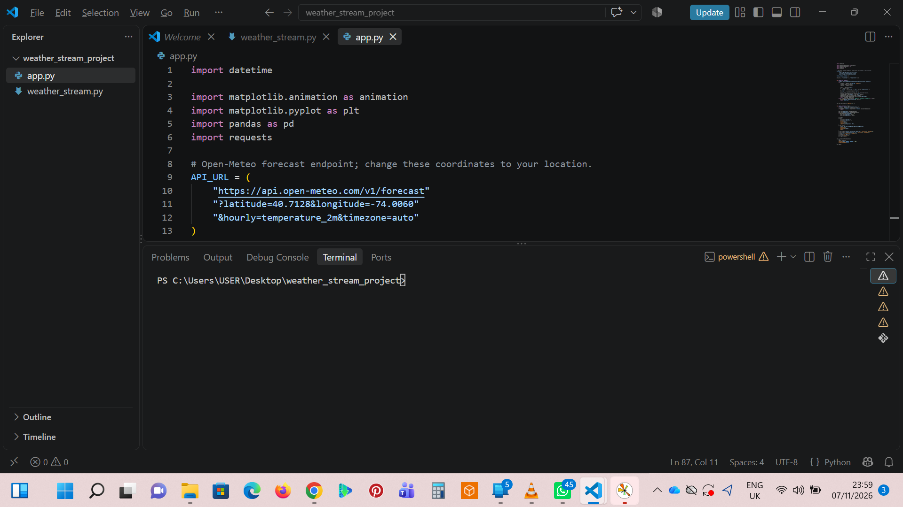
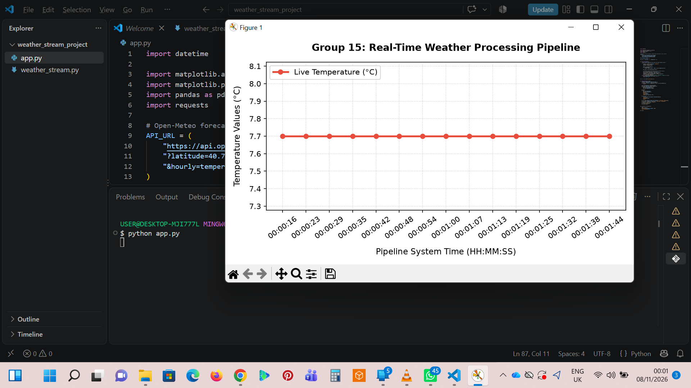

# Real-Time Weather Data Processing Pipeline

An automated, real-time data ingestion and processing pipeline that fetches live climate telemetry, structures it into relational data matrices, and provides dynamic data visualizations. 

## 👥 Group Information
* **Group Number:** Group 15
* **Project Focus:** Real-Time Data Processing

---

## 🚀 System Architecture & Workflow

The system is engineered using a decoupled three-stage data pipeline:
1. **Data Ingestion (REST API):** The system establishes an HTTP GET connection to the Open-Meteo REST API endpoint, pulling raw geographical and climate datasets seamlessly without requiring local data persistence.
2. **Data Parsing & Transformation (Pandas):** The incoming unstructured JSON payload is ingested by `pandas`. The system handles the nested vectors (`time` and `temperature_2m`), indexing them into a structured relational DataFrame matrix.
3. **Dynamic Visualization Loop (Matplotlib):** A streaming execution loop maps the structured timeline elements onto a live chart canvas, dynamically updating every few seconds to reflect moving trendlines.

---

## 🛠️ Tech Stack & Installation

* **Language:** Python 3.x
* **Network & Ingestion:** `requests`
* **Data Processing & Matrices:** `pandas`
* **Data Visualization Canvas:** `matplotlib`

### 1. Install Dependencies
```bash
pip install requests pandas matplotlib
```

### 2. Run the Pipeline
```bash
python app.py
```

---

## 📸 Pipeline Verification & Results

### 1. Environment Setup


_Figure 1: Initializing the development environment and installing dependencies._

---

### 2. Live API JSON Payload


_Figure 2: Verifying the raw REST API JSON response from the Open-Meteo endpoint._

---

### 3. Core Code Implementation


_Figure 3: Core data pipeline script implementing the requests and pandas workflow._

---

### 4. Structured Data & Live Dashboard Output


---



